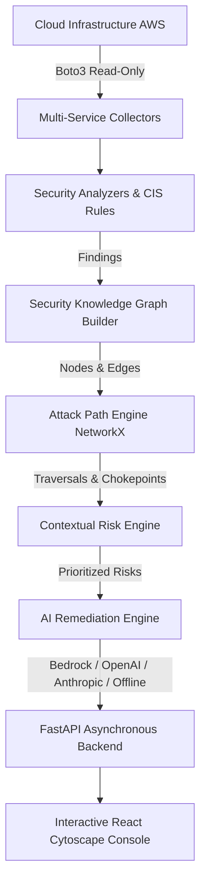

# 🛡️ CloudSentinel AI

[](https://github.com/Harshtech31/CloudSentinelAI/actions/workflows/lint.yml)
[](https://github.com/Harshtech31/CloudSentinelAI/actions/workflows/test.yml)
[](https://github.com/Harshtech31/CloudSentinelAI/actions/workflows/docker-build.yml)
[](https://opensource.org/licenses/MIT)
[](https://www.python.org/)
[](https://fastapi.tiangolo.com/)
[](https://react.dev/)
[](https://www.typescriptlang.org/)

**CloudSentinel AI** is an enterprise-grade **Cloud Security Posture Management (CSPM)** and **Automated Attack Path Analysis** platform. It continuously inventories multi-cloud assets, models relationships into a graph knowledge topology, exposes high-risk lateral traversal trajectories, and generates tailored remediation guidance powered by generative AI or deterministic rulebooks.

---

## ✨ Key Capabilities

- **🔍 Multi-Service Cloud Auditing**: Real-time read-only inspection across AWS IAM, EC2, S3, RDS, VPCs, Security Groups, CloudTrail, and AWS Config.
- **🕸️ Graph-Based Attack Path Analysis**: Uses graph theory (NetworkX) to discover multi-hop lateral attack trajectories from public ingress points down to crown-jewel data assets.
- **⚡ Contextual Risk Scoring Engine**: Evaluates exposure, exploitability, and blast radius to score findings (0.0 – 10.0 scale) and prioritize remediations.
- **🤖 Multi-Model AI Remediation Engine**:
  - **Amazon Bedrock**: Claude 3.5 Sonnet & Haiku models via native AWS credentials.
  - **OpenAI**: GPT-4o & GPT-4o-mini for rapid step-by-step remediation scripts.
  - **Anthropic**: Direct Claude API integration.
  - **Deterministic Rulebook Catalog**: 100% offline, privacy-safe, non-hallucinating CLI guidance with zero third-party API dependencies.
- **📋 CIS AWS Benchmark Compliance**: Automated verification against the CIS AWS Foundations Benchmark with category scores and compliance tracking.
- **📊 Multi-Format Audit Reports**: Generate exportable audit artifacts in standalone styled **HTML**, executive **PDF**, spreadsheet **CSV**, or machine-readable **JSON**.
- **🔒 Least-Privilege Tenant Onboarding**: Dedicated read-only IAM policy template with live STS `GetCallerIdentity` validation and tenant isolation.

---

## 🏛️ System Architecture



---

## 🚀 Quick Start with Docker

Ensure [Docker](https://docs.docker.com/get-docker/) and [Docker Compose](https://docs.docker.com/compose/) are installed.

```bash
# 1. Clone the repository
git clone https://github.com/Harshtech31/CloudSentinelAI.git
cd CloudSentinelAI

# 2. Configure environment variables
cp .env.example .env

# 3. Launch all services (PostgreSQL, Backend API, Frontend Console)
docker compose up --build -d

# 4. Verify service status
docker compose ps
```

### Access Endpoints

- 🌐 **Web Console**: [http://localhost:5173](http://localhost:5173)
- 🔌 **REST API**: [http://localhost:8000](http://localhost:8000)
- 📖 **Interactive OpenAPI (Swagger)**: [http://localhost:8000/docs](http://localhost:8000/docs)
- ❤️ **Health Telemetry**: [http://localhost:8000/api/v1/health](http://localhost:8000/api/v1/health)

---

## 💻 Local Development Setup

### Backend (Python 3.11+)

```bash
cd backend

# Create and activate virtual environment
python3 -m venv .venv
source .venv/bin/activate  # On Windows: .venv\Scripts\activate

# Install dependencies
pip install -r requirements.txt

# Start backend server with auto-reload
uvicorn app.main:app --host 127.0.0.1 --port 8000 --reload
```

### Frontend (Node 20+)

```bash
cd frontend

# Install dependencies
npm install

# Start Vite development server
npm run dev
```

---

## 🔐 AWS IAM Setup & Least-Privilege Policy

CloudSentinel AI requires strictly read-only inspection privileges.

1. **Recommended**: Create a dedicated IAM user named `cloudsentinel-auditor` with programmatic access.
2. **Attach Policy**: Attach the least-privilege policy provided in [`docs/cloudsentinel_audit_iam_policy.json`](docs/cloudsentinel_audit_iam_policy.json).
3. **Step-by-Step Guide**: See [`docs/iam_onboarding_guide.md`](docs/iam_onboarding_guide.md) for complete IAM user creation instructions.

---

## 🧪 Testing & Code Quality

CloudSentinel AI enforces code formatting, static type checking, and unit test coverage in CI workflows:

```bash
# Backend Quality Checks (from backend/ directory)
ruff format --check .       # Check code formatting
ruff check .                # Lint codebase
pytest tests/unit/          # Execute unit test suite (145+ tests)

# Frontend Verification (from frontend/ directory)
npm run build               # Typecheck with TypeScript and build Vite bundle
```

---

## 📁 Repository Structure

```
.
├── .github/workflows/       # GitHub Actions CI/CD (lint, test, docker-build)
├── backend/
│   ├── app/
│   │   ├── ai/              # Bedrock, OpenAI, Anthropic, & fallback engines
│   │   ├── analyzers/       # Security misconfiguration & CIS compliance rules
│   │   ├── api/v1/          # REST endpoints (auth, onboarding, scan, graph, findings, reports)
│   │   ├── attack_engine/   # Graph traversal & lateral attack chain discovery
│   │   ├── auth/            # JWT authentication, Argon2/Bcrypt & RBAC
│   │   ├── collectors/      # AWS service collectors (IAM, EC2, S3, RDS, VPC)
│   │   ├── core/            # Config, logging, security constants, error handlers
│   │   ├── database/        # SQLAlchemy models, sessions, & repositories
│   │   ├── graph/           # Knowledge graph schema & NetworkX graph engine
│   │   ├── reports/         # Standalone HTML, PDF, JSON, and CSV renderers
│   │   ├── risk_engine/     # Contextual risk calculators
│   │   └── tasks/           # Background scan pipeline orchestrator
│   ├── tests/unit/          # Pytest automated test suite
│   ├── Dockerfile
│   ├── pyproject.toml
│   └── requirements.txt
├── frontend/
│   ├── src/
│   │   ├── api/             # Typed API client services
│   │   ├── components/      # UI components (Sidebar, Navbar, SlideDrawer, Toast)
│   │   ├── contexts/        # Auth and session context providers
│   │   ├── pages/           # Views (Dashboard, Graph, Findings, Scan, Compliance, Reports, Settings, Onboarding)
│   │   ├── routes/          # RequireAuth & RequireOnboarded guards
│   │   └── store/           # Zustand client stores
│   ├── package.json
│   └── Dockerfile
├── docs/
│   ├── cloudsentinel_audit_iam_policy.json  # Least-privilege IAM policy
│   └── iam_onboarding_guide.md              # Dedicated auditor setup guide
├── docker-compose.yml
├── .env.example
├── LICENSE
└── README.md
```

---

## 📄 License

This project is licensed under the MIT License — see the [LICENSE](LICENSE) file for details.
